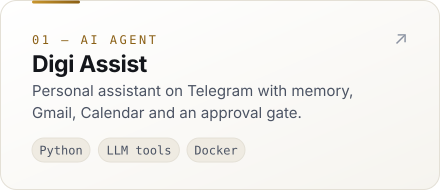
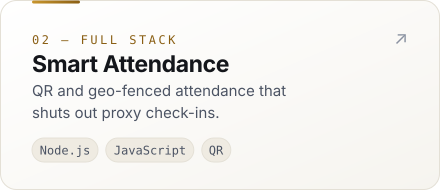
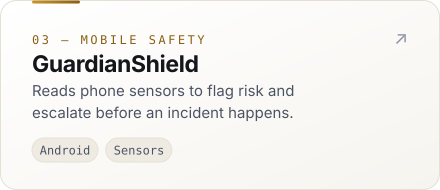
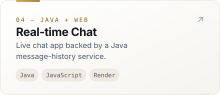

<picture>
  <source media="(prefers-color-scheme: dark)" srcset="assets/banner-dark.svg">
  <source media="(prefers-color-scheme: light)" srcset="assets/banner-light.svg">
  
</picture>

 

  
  
  

 

### About

Hey, I'm Bharath. I'm doing my BTech in CSE and I spend most of my free time building things. Usually that means a Java or Node backend, a simple web front end, and a deploy on Vercel or Render so my friends can actually try it.

These days I'm working on Digi Assist, a Telegram bot that keeps track of my emails, calendar and reminders. It always asks me before it sends anything. I'm also slowly picking up Spring Boot and React.

If you want to talk Java, web dev, or whatever you're building, say hi.

 

### Selected work

<table>
  <tr>
    <td width="50%">
      <a href="https://github.com/Bharath5551/Digi_Assist">
        <picture>
          <source media="(prefers-color-scheme: dark)" srcset="assets/card-digi-assist-dark.svg">
          
        </picture>
      </a>
    </td>
    <td width="50%">
      <a href="https://github.com/Bharath5551/smart-attendance-backend">
        <picture>
          <source media="(prefers-color-scheme: dark)" srcset="assets/card-smart-attendance-dark.svg">
          
        </picture>
      </a>
    </td>
  </tr>
  <tr>
    <td width="50%">
      <a href="https://github.com/Bharath5551/GuardianShield">
        <picture>
          <source media="(prefers-color-scheme: dark)" srcset="assets/card-guardianshield-dark.svg">
          
        </picture>
      </a>
    </td>
    <td width="50%">
      <a href="https://github.com/Bharath5551/real-time-chat-app">
        <picture>
          <source media="(prefers-color-scheme: dark)" srcset="assets/card-realtime-chat-dark.svg">
          
        </picture>
      </a>
    </td>
  </tr>
</table>

Also: <a href="https://kinglifts.vercel.app">KingLifts</a> gym memberships · <a href="https://java-chat-api-v2.onrender.com">Java chat history API</a> · <a href="https://bharathmportfolio.vercel.app">this portfolio</a>

  

### Toolkit

  

 

Looking for internships. Email is the easiest way to reach me.

